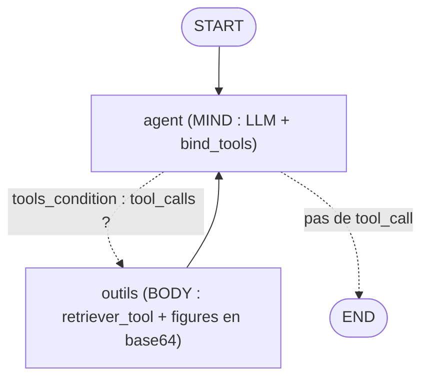

## Progression
- [x] Étape 0 : Initialisation du projet
- [x] Étape 1 : Extraction du contenu multimodal (texte & images)
- [x] Étape 2 : Embeddings CLIP dans un espace latent commun
- [x] Étape 3 : Indexation dans ChromaDB
- [x] Étape 4 : Recherche multimodale par similarité cosinus
- [x] Étape 5 : Retriever transformé en outil agentique
- [x] Étape 6 : Agent ReAct avec LangGraph
- [ ] Étape 7 : Tests et validation

## Structure
- `data/` : PDF source
- `notebooks/` : un notebook par étape, avec les sorties
- `src/embeddings.py` : encodage CLIP (texte et image) et découpage en chunks
- `src/indexation.py` : ouverture de la collection ChromaDB persistante (`pdf_clip_vit_b32`, distance cosinus)
- `src/recherche.py` : recherche multimodale par similarité cosinus (`rechercher`) et recherche hybride par modalité (`rechercher_hybride`)
- `src/outils.py` : `retriever_tool`, la recherche exposée comme outil LangChain pour l'agent (sources `[S1]`… + artifact brut)
- `src/agent.py` : agent ReAct construit à la main avec LangGraph (nœuds `agent` / `outils`) et un LLM local Ollama (`qwen3-vl:4b`), `interroger_agent(texte, image)`

## Graphe de l'agent

